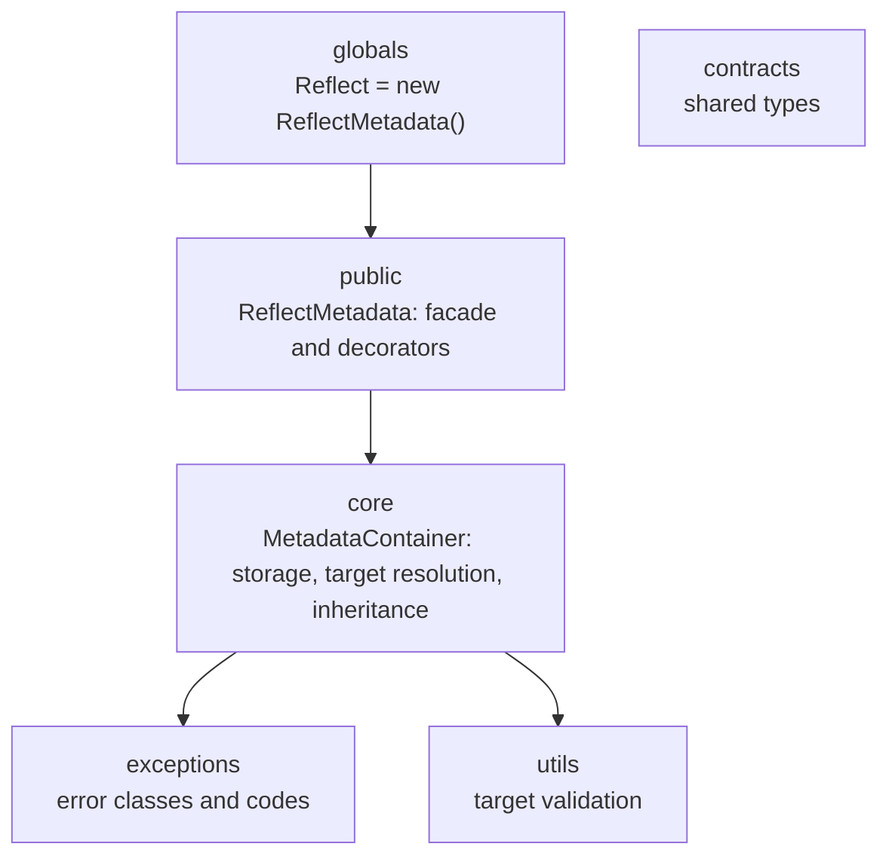
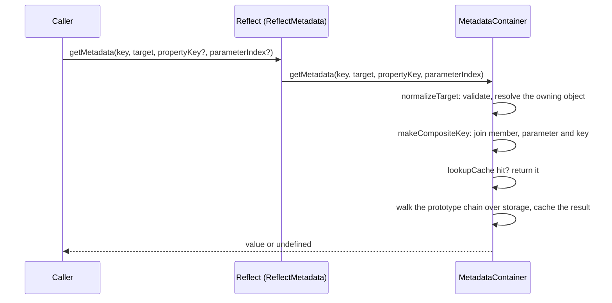
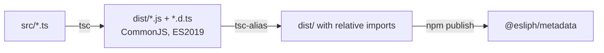

# Architecture overview

This page is for contributors. It explains how the source is divided, how a call travels through it, and how the repository turns the source into the published package. The storage engine is detailed in [Storage model](storage-model.md), and the reasons behind the structure in [Design decisions](design-decisions.md).

## Layers

The library has three layers. Each one delegates to the one below it:

`contracts` holds types only, and every layer may import it. No module imports a layer above its own.

| Module     | Path                             | Responsibility                                                                                                                                                            | Imports                |
| ---------- | -------------------------------- | ------------------------------------------------------------------------------------------------------------------------------------------------------------------------- | ---------------------- |
| globals    | `src/globals/index.ts`           | Creates the shared `Reflect` instance.                                                                                                                                    | public                 |
| public     | `src/public/reflect-metadata.ts` | `ReflectMetadata`: forwards storage calls to its container and builds the `metadata` and `metadataParam` decorators.                                                      | core, contracts        |
| core       | `src/core/container.ts`          | `MetadataContainer`: storage maps, target normalization, composite keys, prototype-chain lookup, lookup cache.                                                            | core/target, contracts |
| core       | `src/core/target.ts`             | `assertValidTarget`: throws when a target is invalid.                                                                                                                     | exceptions, utils      |
| exceptions | `src/exceptions/`                | `ReflectMetadataException`, `InvalidTargetReflectMetadataException`, `ReflectMetadataErrorCode`.                                                                          | —                      |
| utils      | `src/utils/target.ts`            | `isValidTarget`: accepts objects and functions that have a `prototype`, except functions whose constructor is named `GeneratorFunction` (async generator functions pass). | contracts              |
| contracts  | `src/contracts/metadata.ts`      | `MetadataTarget`, `MetadataKey`, `MetadataValue`, `PropertyKey`.                                                                                                          | —                      |

`src/index.ts` re-exports `contracts`, `core`, `exceptions`, `globals` and `public`. `assertValidTarget` and `isValidTarget` are not exported, because `src/core/index.ts` exports only the container and `src/utils` has no index.

## Path of a call

A read through the global instance:

`ReflectMetadata` adds nothing to storage calls: each of its six storage methods is one line that calls the container method of the same name.

A decorator follows a different path. `metadata` and `metadataParam` capture the instance's container in a closure. A class decorator calls `container.defineMetadata` immediately. A member decorator registers an initializer that calls it later, with `this` set to the class (static members) or to the new instance (instance members); [Decorators and initializers](../decorators-and-initializers.md) explains when that runs.

## Repository layout

| Path                                | Contents                                                                                                                    |
| ----------------------------------- | --------------------------------------------------------------------------------------------------------------------------- |
| `src/`                              | Library source, as described above.                                                                                         |
| `tests/internal/`                   | Specs of `MetadataContainer`, one file per location kind (class, method, property, parameter), plus `utils/target.spec.ts`. |
| `tests/public/`                     | Specs of `ReflectMetadata`: the storage API and the decorators.                                                             |
| `tests/common/types-target-list.ts` | Valid and invalid targets shared by the specs.                                                                              |
| `tests/tsconfig.json`               | Extends the root config, adds the `@tests/*` alias and includes the tests for type checking.                                |
| `docs/`                             | This documentation.                                                                                                         |
| `.github/workflows/publish.yml`     | Release workflow.                                                                                                           |

Imports inside `src` use the `@*` alias for `src/*`, for example `@core/container`. Vitest resolves it through `vite-tsconfig-paths`.

## From source to package

1. `tsc` compiles `src` to CommonJS targeting ES2019, with declaration files, into `dist/` (`tsconfig.json`).
2. `tsc-alias` rewrites the `@*` imports in `dist/` into relative paths, because Node does not resolve TypeScript path aliases.
3. `package.json` publishes `dist/` (`files`), plus the files npm always includes, such as `package.json` and `README.md`. `main` is `dist/index.js` and `types` is `dist/index.d.ts`.
4. Publishing a GitHub release runs `.github/workflows/publish.yml`: `npm ci`, `npm run build`, `npm publish`. `npm publish` triggers `prepublishOnly`, which builds again. No test runs in the workflow.

In `exports["."]`, the `types` condition comes after `import` and `require`, and points to `./index.d.ts`, a file the package does not contain. TypeScript still finds the declarations: it resolves `./dist/index.js` through `import` or `require` and reads the `.d.ts` file next to it. esbuild warns that the `types` condition is never used.

The commands for each step are in [Develop the library](../../how-to/develop-the-library.md).
