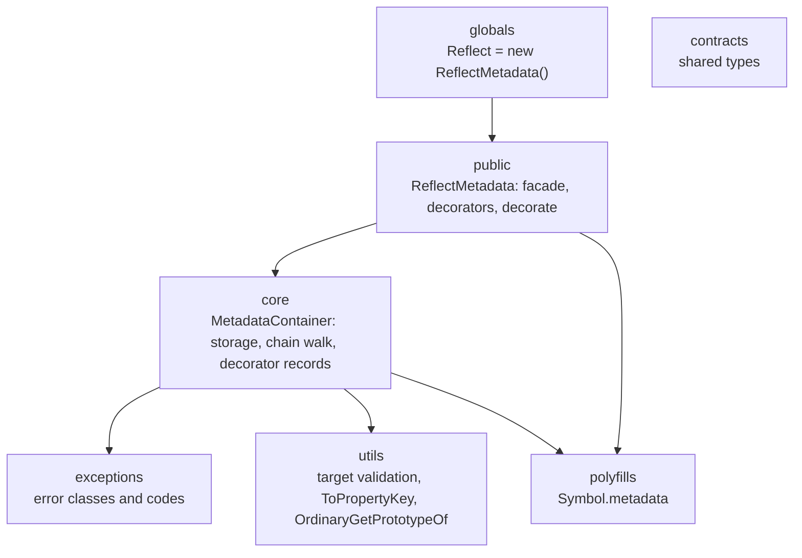
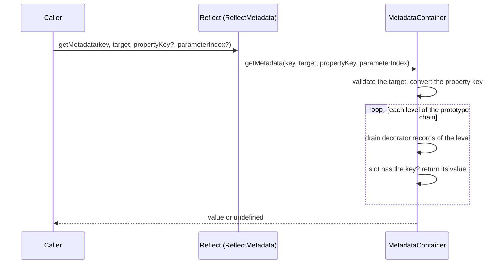
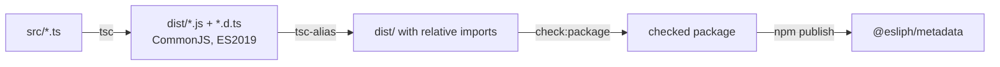

# Architecture overview

This page is for contributors. It explains how the source is divided, how a call travels through it, and how the repository turns the source into the published package. The storage engine is detailed in [Storage model](storage-model.md), and the reasons behind the structure in [Design decisions](design-decisions.md).

## Layers

The library has three layers. Each one delegates to the one below it:

`contracts` holds types only, and every layer may import it. No module imports a layer above its own.

| Module     | Path                             | Responsibility                                                                                                                                | Imports                       |
| ---------- | -------------------------------- | --------------------------------------------------------------------------------------------------------------------------------------------- | ----------------------------- |
| globals    | `src/globals/index.ts`           | Creates the shared `Reflect` instance.                                                                                                        | public                        |
| public     | `src/public/reflect-metadata.ts` | `ReflectMetadata`: forwards storage calls to its container, builds the `metadata` and `metadataParam` decorators and forwards `decorate`.     | core, polyfills, contracts    |
| public     | `src/public/decorate.ts`         | `decorate`: the class and member forms, with the validation order of `reflect-metadata`.                                                      | core/target, exceptions, utils |
| core       | `src/core/container.ts`          | `MetadataContainer`: operations, prototype-chain walk, decorator records, stamps.                                                             | core, polyfills, utils        |
| core       | `src/core/target-metadata.ts`    | `TargetMetadata` and `MetadataSlot`: the slot tables of one target.                                                                           | contracts                     |
| core       | `src/core/decorator-record.ts`   | `DecoratorRecord`: what a member decorator records.                                                                                           | contracts                     |
| core       | `src/core/target.ts`             | `assertValidTarget`: throws when a target is invalid.                                                                                         | exceptions, utils             |
| polyfills  | `src/polyfills/symbol-metadata.ts` | Defines `Symbol.metadata` when the runtime lacks it and exports `SYMBOL_METADATA`.                                                          | —                             |
| exceptions | `src/exceptions/`                | `ReflectMetadataException` (a `TypeError`), `InvalidTargetReflectMetadataException`, `ReflectMetadataErrorCode`.                               | —                             |
| utils      | `src/utils/`                     | `isValidTarget` (`IsObject`), `toPropertyKey` (`ToPropertyKey`) and `ordinaryGetPrototypeOf` (`OrdinaryGetPrototypeOf`).                       | contracts                     |
| contracts  | `src/contracts/metadata.ts`      | `MetadataTarget`, `MetadataKey`, `MetadataValue`, `PropertyKey`.                                                                              | —                             |

`src/index.ts` imports the polyfill first, then re-exports `contracts`, `core`, `exceptions`, `globals` and `public`. `assertValidTarget` and `isValidTarget` are not exported, because `src/core/index.ts` exports only the container and `src/utils` has no index.

## Path of a call

A read through the global instance:

`ReflectMetadata` adds nothing to storage calls: each storage method is one line that calls the container method of the same name.

A decorator follows a different path. `metadata` and `metadataParam` capture the instance's container in a closure. A class decorator calls `container.defineMetadata` immediately. A member decorator appends a record to `context.metadata`, and the container copies it when an operation first touches the class; [Decorators and initializers](../decorators-and-initializers.md) explains when that happens.

## Repository layout

| Path                                | Contents                                                                                                                    |
| ----------------------------------- | --------------------------------------------------------------------------------------------------------------------------- |
| `src/`                              | Library source, as described above.                                                                                         |
| `tests/internal/`                   | Specs of `MetadataContainer`, one file per location kind (class, method, property, parameter), plus the specs of `utils/`.  |
| `tests/public/`                     | Specs of `ReflectMetadata`: the storage API, `decorate` and the decorators.                                                 |
| `tests/parity/`                     | The differential suite: each scenario runs on the library and on `reflect-metadata/no-conflict`.                            |
| `tests/emit/`                       | Compiles fixtures with `tsc` and runs them in a fresh Node process, to cover the `Symbol.metadata` polyfill.                |
| `tests/common/types-target-list.ts` | Valid and invalid targets shared by the specs.                                                                              |
| `tests/tsconfig.json`               | Extends the root config, adds the `@tests/*` alias and includes the tests for type checking.                                |
| `scripts/check-package.mjs`         | Checks the built package (`npm run check:package`).                                                                         |
| `docs/`                             | This documentation.                                                                                                         |
| `.github/workflows/publish.yml`     | Release workflow.                                                                                                           |

Imports inside `src` use the `@*` alias for `src/*`, for example `@core/container`. Vitest resolves it through `vite-tsconfig-paths`.

## From source to package

1. `tsc -p tsconfig.build.json` compiles `src` to CommonJS targeting ES2019, with declaration files, into `dist/`.
2. `tsc-alias` rewrites the `@*` imports in `dist/` into relative paths, because Node does not resolve TypeScript path aliases.
3. `npm run check:package` verifies the manifest (`types` first in `exports`, no `sideEffects` that would drop the polyfill), the packed file list, and installs the package in a temporary project that compiles a consumer file and requires the package.
4. `package.json` publishes `dist/` (`files`), plus the files npm always includes, such as `package.json` and `README.md`.
5. Publishing a GitHub release runs `.github/workflows/publish.yml`: `npm ci`, lint, type check, tests, build, `npm run check:package`, `npm publish`. `npm publish` triggers `prepublishOnly`, which builds again.

The commands for each step are in [Develop the library](../../how-to/develop-the-library.md).
